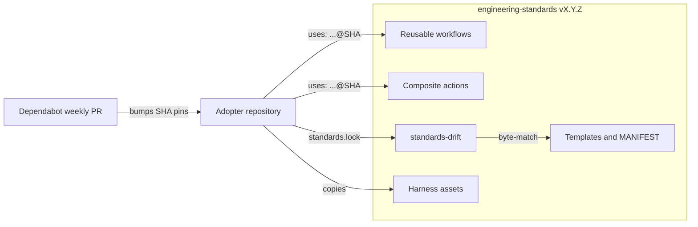

<!-- Variant: PUBLIC -->
<div align='center'>
  <h1>engineering-standards</h1>
  <p>Shared CI, security, templates, rulesets and agent harness for the ecosystem repositories.</p>
  <a href='https://github.com/gonzalomartinperez/engineering-standards/actions/workflows/ci.yml'></a>
  <a href='https://github.com/gonzalomartinperez/engineering-standards/releases'></a>
  <a href='LICENSE'></a>
</div>

## Why

Nine repositories share one way of working: one fail-closed required check, CI that runs only what a
change affects, one weekly dependency PR, the same security scanners, the same community files and
the same agent harness. This repository is the single place where those pieces live, are tested and
are released, so each repository pins one commit instead of copying and drifting.

## Highlights

- `classify` picks CI profiles from changed files, branch and labels and fails closed; `ci-gate` is
  the single required check and fails when a selected job was skipped.
- Every workflow is SHA-pinned, starts from `permissions: {}`, hardens the runner and is checked by
  zizmor, actionlint and a policy test on every PR.
- The Dependabot weekly group shape was proven live on a sandbox ([ADR 0002](docs/decisions/0002-dependabot-weekly-group-sandbox-proof.md)).
- `standards-drift` byte-matches adopter copies against the pinned release and enforces the
  Dependabot policy.
- The embedded workflow logic is unit-tested by extracting the scripts from the YAML ([ADR 0001](docs/decisions/0001-ci-gate-composite-and-embedded-logic.md)).

## Architecture



Adopters depend on a release by commit SHA only; no runtime code crosses repositories. Reusable
workflows are self-contained at their pin; only `drift.yml` checks out this repository, at the commit
in the adopter's `standards.lock`.

## Quickstart

```bash
git clone https://github.com/gonzalomartinperez/engineering-standards.git && cd engineering-standards
uv run --with pyyaml==6.0.3 python -m unittest discover -s tests   # all logic tests
uvx zizmor==1.32.0 --persona regular .github/workflows actions        # workflow security
```

Requirements: Python 3.13+, [uv](https://docs.astral.sh/uv/), `jq`, `shellcheck`; `gh` for the rulesets script.

## Usage

| Piece | Path | Adopt with |
|---|---|---|
| CI profiles | `.github/workflows/classify.yml` + `.github/ci-profile.json` | `templates/workflows/ci.yml` |
| Required check | `actions/ci-gate` | caller job named `ci-gate` |
| Security set | `.github/workflows/security.yml` | `security` job in `ci.yml` |
| Docs fast path | `.github/workflows/docs.yml` | `docs` job in `ci.yml` |
| Setup | `actions/setup-node`, `actions/setup-python-uv` | step-level `uses:` |
| Weekly dependency PR | `templates/dependabot/*.yml`, `.github/workflows/deps-weekly-guard.yml` | `templates/workflows/deps-weekly-guard.yml` |
| Daily vulnerabilities | `.github/workflows/vuln-daily.yml` | `templates/workflows/vuln-daily.yml` |
| Drift | `tools/standards_drift.py`, `.github/workflows/drift.yml` | `standards.lock` |
| Rulesets | `rulesets/`, `scripts/apply-rulesets.sh` | dry run, then `--apply` |
| Harness | `harness/` (hooks, agents, settings, Codex, skills) | [harness/README.md](harness/README.md) |

All reusable workflows accept an optional `runner` input (default: `ubuntu-latest`).
When hosted Actions minutes run out on private repos, pass a self-hosted runner label via
`runner: ${{ vars.CI_RUNNER || 'ubuntu-latest' }}` under the caller job's `with:` and set `CI_RUNNER` to that label.

Step-by-step adoption with exact snippets: [docs/how-to/adopt.md](docs/how-to/adopt.md).

## Quality

| Gate | Tool | Threshold |
|---|---|---|
| Required check | `ci-gate` (this repo's own profiles) | green on every PR; rulesets require it |
| Workflow security | zizmor (regular persona), actionlint | no findings at medium or above |
| Workflow policy | `tests/test_workflow_policy.py` | SHA pins, `permissions: {}`, harden-runner, no `${{ }}` in `run:` |
| Logic | unit tests (`tests/`) | all pass; embedded scripts executed |
| Self-test | `ci.yml` calls `./.github/workflows/*` and `./actions/*` | green |
| Docs | markdownlint, lychee, check-skills | no findings |

## Documentation

- How-to: [adopt](docs/how-to/adopt.md) · [CodeQL](docs/how-to/codeql.md)
- Reference: [schemas](schemas/) · [templates](templates/) · [rulesets](rulesets/)
- Explanation: [ADRs](docs/decisions/) · [ecosystem standard](standard/ecosystem.md)
- Tracker: [progress/ecosystem.md](progress/ecosystem.md) (milestones and resume instructions)

## Ecosystem

| Repository | Role |
|---|---|
| [portfolio](https://github.com/gonzalomartinperez/portfolio) | Public bilingual portfolio site |
| [portfolio-assistant-api](https://github.com/gonzalomartinperez/portfolio-assistant-api) | Portfolio assistant API (RAG, evals) |
| [portfolio-backoffice](https://github.com/gonzalomartinperez/portfolio-backoffice) | Portfolio backoffice (IAM, operations) |
| [pequeverso](https://github.com/gonzalomartinperez/pequeverso) | Pequeverso public store site |
| [pequeverso-assistant-api](https://github.com/gonzalomartinperez/pequeverso-assistant-api) | Pequeverso shopping assistant API |
| [pequeverso-backoffice](https://github.com/gonzalomartinperez/pequeverso-backoffice) | Pequeverso backoffice (IAM, operations) |
| vps-ops (private) | Operations CLI and deploy contract |

## Contributing and security

See [CONTRIBUTING.md](CONTRIBUTING.md), [SECURITY.md](SECURITY.md) and [CODE_OF_CONDUCT.md](CODE_OF_CONDUCT.md).
Every change lands through a PR with a green `ci-gate`; releases are tagged from `VERSION` and `CHANGELOG.md`.

## Scope and limits

- No secrets, ever: the repository is public and consumed by public and private repositories.
- Design tokens (M5) and eval tooling (M2) are placeholders ([tokens/](tokens/), [eval-tooling/](eval-tooling/)).
- Image build, attestation and release workflows for the Docker repositories arrive in later minor versions.

## License

MIT — see [LICENSE](LICENSE).
