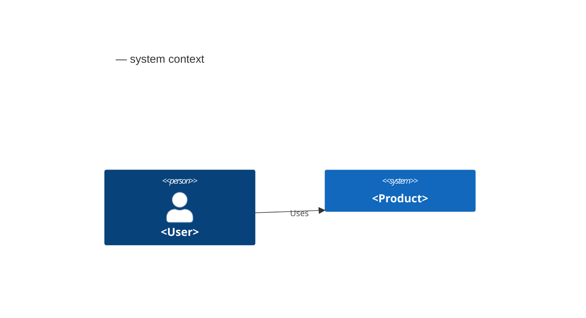

<!-- README template (ecosystem standard 14.1), PRIVATE variant. 80–180 lines. Replace REPO and every <placeholder>. -->
<!-- Checked by docs.yml: headings in this order, length, at most three badges, no to-do markers, alt on images. -->
<div align='center'>
  
  <h1><Product name></h1>
  <p><One-line value proposition, 120 characters at most.></p>
  <a href='https://github.com/gonzalomartinperez/REPO/actions/workflows/ci.yml'></a>
  <a href='https://github.com/gonzalomartinperez/REPO/releases'></a>
</div>

<picture>
  <source media='(prefers-color-scheme: dark)' srcset='docs/assets/hero-dark.png'>
  " width='100%'>
</picture>

## Why

<Three to five sentences: the problem, who it serves, what makes it different.>

## Highlights

- <Measured, verifiable bullet; numbers link to CI evidence or docs.>
- <Three to six bullets.>

## Architecture



<Two sentences on the dependency rule.> Details: [docs/architecture.md](docs/architecture.md).

## Quickstart

```bash
<one command setup>     # e.g. npm run setup
<one command check>     # mirrors CI: npm run check
<one command run>       # e.g. npm run dev
```

Requirements: <Node 24 LTS / Python 3.14>, <Docker if needed>.

## Where it runs

<Environments, how it is operated, links to runbooks.>

## Quality

| Gate | Tool | Threshold |
|---|---|---|
| Required check | `ci-gate` (shared CI profiles) | green on every PR |
| <Unit and coverage> | <Vitest / pytest> | <floor> |

Scorecard: [docs/master-plan/scorecard.md](docs/master-plan/scorecard.md).

## Documentation

Tutorials · How-to · Reference · Explanation ([ADRs](docs/decisions/)) · [Master plan](docs/master-plan/).

## Ecosystem

<The repositories this one relates to (private business repos are never listed in public READMEs).>

## Contributing and security

See [CONTRIBUTING.md](CONTRIBUTING.md) and [SECURITY.md](SECURITY.md).

## Scope and limits

- <Up to four bullets.>

## License

Proprietary. All rights reserved.
